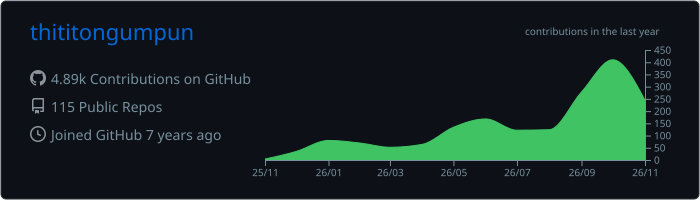
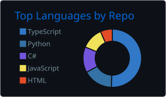
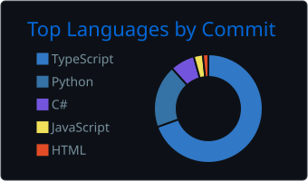
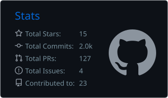
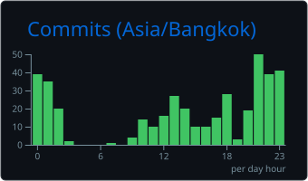

<h1 align="center">Hi, I'm Thiti 👋</h1>

  

  
  

### 🛠️ Tech stack

  

### 📊 GitHub stats

  

  
  

  
  

### 🐍 Contributions

<picture>
  <source media="(prefers-color-scheme: dark)" srcset="https://raw.githubusercontent.com/thititongumpun/thititongumpun/output/github-snake-dark.svg" />
  <source media="(prefers-color-scheme: light)" srcset="https://raw.githubusercontent.com/thititongumpun/thititongumpun/output/github-snake.svg" />
  
</picture>
